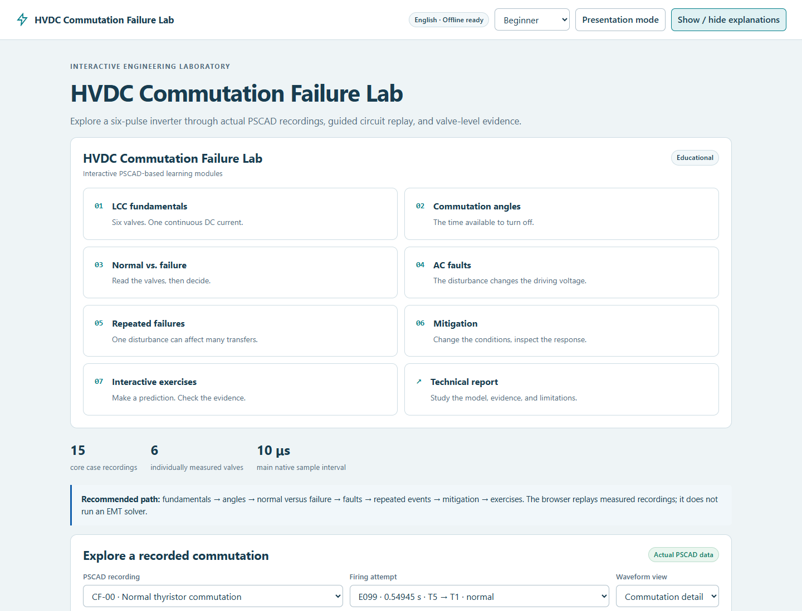

# HVDC Commutation Failure Lab

An English educational laboratory connecting a standalone six-pulse LCC inverter, actual PSCAD recordings, valve-level failure evidence, and eight interactive learning pages.

- **Online laboratory:** https://angelohafner.github.io/hvdc-lcc-commutation-failure-lab/
- **Source repository:** https://github.com/angelohafner/hvdc-lcc-commutation-failure-lab
- **Offline download and PDF:** [latest release](https://github.com/angelohafner/hvdc-lcc-commutation-failure-lab/releases/latest)
- **Publication audit:** [findings and resolutions](reports/publication_audit.md)
- Local learning hub: [docs/index.html](docs/index.html)
- Detailed report: [HTML](docs/technical_report.html) and [PDF](reports/HVDC_LCC_Technical_Report.pdf)
- Engineering audit: [results/summary/engineering_audit.json](results/summary/engineering_audit.json)
- Case table: [results/summary/case_summary.csv](results/summary/case_summary.csv)



## What students can explore

| Module | Learning task |
|---|---|
| 00 - Learning hub | Follow the learning path and inspect available recordings |
| 01 - LCC fundamentals | Identify valves, conduction paths, firing order and power direction |
| 02 - Commutation angles | Follow current transfer, reverse bias, alpha, beta, mu and gamma |
| 03 - Normal versus failure | Compare measured valve waveforms on synchronized scales |
| 04 - AC faults | Compare sag, ground and phase faults, severity and inception timing |
| 05 - Repeated failures | Select individual attempts and inspect recovery and recurrence |
| 06 - Mitigation | Compare precomputed operating points and measured tradeoffs |
| 07 - Exercises | Use graphical valve selection, waveform diagnosis and a scored quiz |

All modules include play/pause/reset, speed, cursor, valve selection, zoom/pan, signal views, event inspection, comparisons, figure export and study/presentation modes. The browser replays actual recordings; it does not solve EMT equations or invent transients between parameter settings.

## Recorded engineering results

There are **31 accepted native PSCAD simulations**: the 15 core cases plus 16 targeted follow-ups, sweeps, mitigations and numerical checks. The final conservative detector identifies **671 verified failed firing attempts** across these separate runs. This is not a count of independent AC faults. Inconclusive attempts are retained separately.

The baseline exports about 144.3 MW at 1.292 kA, with 11.46 degrees of overlap and 28.80 degrees minimum late-record extinction interval. CF-01 demonstrates reduced margin without failure. CF-02 demonstrates retained outgoing current and unsuccessful transfer. CF-06 includes measured reverse voltage followed by resumed conduction. CF-13-R2 demonstrates successful commutation followed by a new verified failure during a prescribed DC restoration transient without a second AC fault. REC-NOMINAL is its stable-recovery comparison.

The tested sag boundary lies between 0.85 and 0.875 pu retained source voltage for this particular operating point, duration and inception. DC voltage reduction prevents verified failures in the matched 50% sag case, with a temporary loss of power and inconclusive low-current attempts. Advancing firing alone does not ensure recovery.

## Open the laboratory

Open `docs/index.html` directly in a recent Chrome or Edge browser. Keep the complete `docs` folder together. Direct `file://` use was tested, including compressed data loading and case comparison. Essential dependencies and fonts are bundled.

An optional local server from the project root:

```powershell
py -3.11 -m http.server 8765 --bind 127.0.0.1 --directory docs
```

Then open http://127.0.0.1:8765/. Students do not need Python or PSCAD when using direct file opening. A portable copy of the website is available from the GitHub release; local packaging writes it under `dist/`.

## Single-file virtual laboratory

[Open the self-contained laboratory directly in your browser](https://angelohafner.github.io/hvdc-lcc-commutation-failure-lab/HVDC_LCC_Virtual_Laboratory.html).

[Download the self-contained HTML (77 MB)](https://github.com/angelohafner/hvdc-lcc-commutation-failure-lab/releases/download/v1.1.0/HVDC_LCC_Virtual_Laboratory.html).

The standalone edition combines all eight modules, the technical report, KaTeX/fonts,
circuit diagrams, report figures, license notices and all 29 student recordings in
one HTML file. Open `dist/HVDC_LCC_Virtual_Laboratory.html` directly in a recent
Chrome or Edge browser. It needs no server, installation, companion folder or
network connection. Optional source/reference links require Internet access only
when explicitly opened. The approximately 77 MB size preserves every recorded
student sample; the browser is a replay laboratory, not an EMT solver.

Use the module selector or internal links. Switching modules pauses playback and
retains each module's cursor, selections and exercise answers for the current
session. Browser Back/Forward and direct module hashes (for example `#3`) work.
Closing or reloading the file resets the session; no persistent storage is required.

Rebuild and verify from the repository:

```powershell
py -3.11 python/build_single_file.py
py -3.11 -m unittest discover -s tests -p test_single_file.py -v
node tests/test_html/single_file.cjs
```

The manifest beside the generated HTML records its size and SHA-256. It is audit
metadata and is not needed to run the HTML. See [standalone verification](reports/single_file_validation.md).

GitHub Pages publishes the tested HTML alongside the multipage site through the
validation workflow. Deployment runs only after the Python and browser checks
pass on `main`. The large generated HTML is included in the Pages artifact and
release downloads, without storing a duplicate generated file in Git history.

## Reproduce PSCAD simulations

Use Windows, a licensed PSCAD 5.1.0 installation, an installed supported Fortran compiler, and Python 3.11. The recorded environment used GFortran 8.1 (64-bit). Set PSCAD's automation port explicitly when more than one instance is running.

```powershell
py -3.11 -m pip install -r requirements.txt
py -3.11 python/check_environment.py --port YOUR_PORT
```

The native baseline project is `pscad/inverter_6_pulse/lcc_inverter.pscx`. Each executed case is in `pscad/simulation_cases/LCC_*.pscx`; open one in PSCAD to inspect and run it manually. Original controller logic and topology can be reconstructed with:

```powershell
py -3.11 python/build_model.py --port YOUR_PORT
```

For automated reproduction, use a separate copy of the project with no existing `results/raw/CASE` folder. The runner deliberately refuses to overwrite evidence. It archives each exact executed project, native outputs, messages and SHA-256 receipt.

```powershell
py -3.11 python/run_simulations.py --port YOUR_PORT --cases CF-00 CF-01 CF-02 CF-03 CF-04 CF-05 CF-06 CF-07 CF-08 CF-09 CF-10 CF-11 CF-12 CF-13 CF-14
py -3.11 python/parameter_sweeps.py --port YOUR_PORT
```

`config/model_parameters.json` describes the nominal point; `config/simulation_cases.json` records all overrides. `run_simulations.py` and `parameter_sweeps.py` are the executable case definitions. `--overrides` accepts a JSON object for a new run. Optional `scr`, `dc_current_reference_a` and `gamma_reference_deg` inputs calculate a sinusoidal feedforward operating point; there is no current/gamma feedback controller. Inspect the resulting measurements.

## Reprocess and rebuild

```powershell
py -3.11 python/rebuild_results.py
py -3.11 -m unittest discover -s tests -v
```

The rebuild reads existing native evidence, verifies project/output hashes, validates timing and units, classifies attempts, creates PNG/SVG plots, refreshes the browser datasets and report, and writes the engineering audit. Shareable PSCAD files remove OS-account author stamps only; `results/summary/release_project_hashes.json` maps them to the unchanged executed archives. Full native outputs and float64 NPZ arrays remain local and are excluded from Git; selected full-precision CSV event windows, summaries, metadata, event records, native projects and compressed browser recordings are included. A downloaded source release must reproduce the native runs before rebuilding the complete study. Native integration tests are explicitly skipped when those local raw files are absent.

For browser QA, install the optional test dependency and serve `docs`:

```powershell
npm install --prefix .local/web playwright@1.65.1
node tests/test_html/interaction.cjs
node python/render_report.cjs
py -3.11 python/package_offline.py
```

Set `CHROME_PATH` for a different installed Chrome location or `LAB_URL` for a served repository subdirectory. The browser test report is `reports/browser_tests.json`. Detailed validation and its limits are in `reports/validation_report.md`.

## Data and model limits

- Six individual native thyristors, floating DC source, series R/L, commutation inductance, grounded Thevenin phase sources, fault branches and an original fixed-frequency firing clock.
- 38 native channels; SI processing adds DC and AC powers. Main samples are 10 microseconds; two representative cases use 5 microseconds.
- Browser recordings preserve every native sample from 0.20 s onward. Float32 conversion error is declared per channel; XOR/byte-plane compression is lossless after that conversion. Overview rendering preserves local extrema.
- Failure requires current/gate/voltage evidence. A low gamma or a depressed DC voltage alone is insufficient. The 15 degree reduced-margin threshold is an educational classification, not a device rating.
- Semiconductor recovery is simplified; no charge-storage or thermal model is validated. There is no transformer, PLL, closed-loop current/gamma regulator, full rectifier station, VDCOL or protection blocking.
- Scripted DC reductions/restoration demonstrate an inverter-only mechanism, not a validated HVDC controller. Fixed-source overcurrents are not equipment ratings. Weak-grid initial current differs from nominal. Two time steps are sensitivity evidence, not a full convergence proof.

## Release checks

GitHub Actions runs the Python suite, release-content audit and all browser integration checks on a source-only checkout. Native evidence tests skip explicitly until the licensed PSCAD runs are reproduced; CI does not execute PSCAD. The publication audit records separately the complete local native checks, offline ZIP verification and live Pages checks.

The first public revision is an audited snapshot. Earlier local development commits and rejected model evidence are preserved locally rather than uploaded. The published history is checked with `python/audit_history.py`; no native solver/master-library implementations, installation binaries, credentials or unrelated documents are distributed.

## License and references

Original work: [MIT](LICENSE), Angelo Hafner. See [third-party notices](THIRD_PARTY_NOTICES.md) and the bundled KaTeX license. Reproduction requires independently licensed PSCAD software.

References: [PSCAD Automation Library](https://www.pscad.com/software/pscad/automation-library), [Power Electronic Switch](https://www.pscad.com/webhelp-pscad-v5.1.0-ol/Master_Library_Models/HVDC_and_FACTS/PE_Switch/peswitch.htm), [Thyristor model behavior](https://www.pscad.com/webhelp-v502-ol/Master_Library_Models/HVDC_and_FACTS/PE_Switch/Thyristor.htm).
